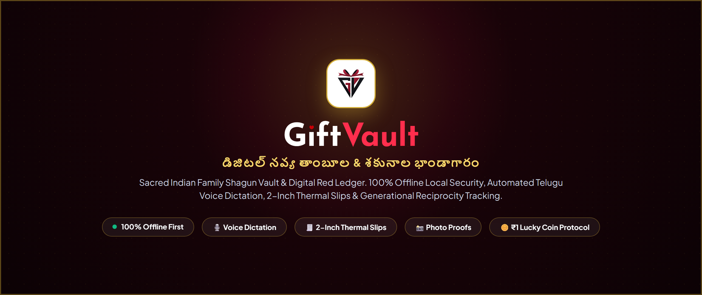
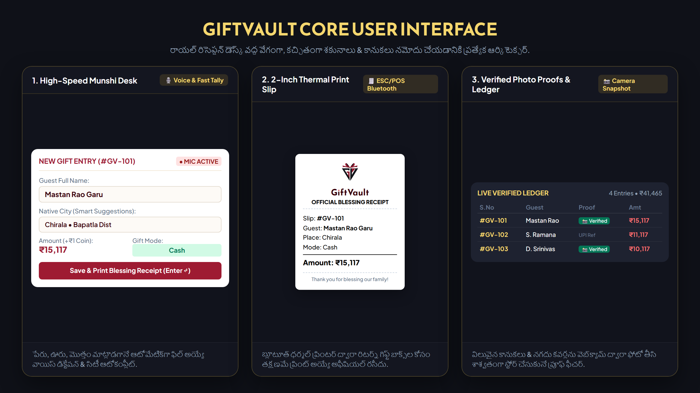

<div align="center">

  

  # GiftVault (గిఫ్ట్‌వాల్ట్) 🎁
  ### *Sacred Indian Family Shagun Vault & Digital Red Notebook*

  <p align="center">
    <strong>డిజిటల్ నవ్య తాంబూల &amp; శకునాల భాండాగారం</strong><br>
    <em>Modernizing Generational Indian Celebration Gifting with 100% Offline Privacy, Hands-Free Voice Dictation &amp; 2-Inch Thermal Slips.</em>
  </p>

  [](LICENSE)
  [-brightgreen)](#-code-craftsmanship--slopdar-audit)
  [](#-zero-cloud-leak-architecture)
  [](#)
  [](CONTRIBUTING.md)

</div>

---

<p align="center">
  
</p>

---

## 🌟 Why GiftVault? (సమస్య &amp; పరిష్కారం)

In Indian weddings (*వివాహం*), housewarmings (*గృహప్రవేశం*), silver jubilees (*రజతోత్సవం*), and cradle ceremonies (*పుట్టెంటకలు / నామకరణం*), guests bless the host family with cash gifts (*Moyyulu*, *Chadhivimpu*, *Tamboolam*, *Shagun*). 

Traditionally, volunteers at chaotic reception desks record these gifts inside a red physical notebook (**Munshi Book / బహీ-ఖాతా**). This physical system frequently suffers from:
* ❌ **Handwriting Illegibility**: Misreading relatives' names or native places after the event.
* ❌ **Lost Slips & Calculation Errors**: Misplaced envelopes and incorrect cash totals under heavy rush.
* ❌ **Privacy & Loss Risks**: Anyone can peek at the open book, or the physical diary can be lost/damaged.
* ❌ **Reciprocity Blindness**: Spending hours searching old paper diaries to know how much a relative gave when you attend their daughter's wedding 3 years later.

**GiftVault** eliminates every single pain point with an elegant, offline-first digital sanctuary tailored for authentic Indian celebration culture.

---

<p align="center">
  
</p>

---

## ✨ Key Features (ప్రధాన ఫీచర్లు)

| Feature | Description | Cultural Context |
| :--- | :--- | :--- |
| 🎙️ **Hands-Free Voice Dictation** | Speak naturally in Telugu or English (*"Mastan Rao Garu, Chirala, 15000 cash"*). GiftVault automatically parses Name, City, Amount, and Gift Mode. | Frees volunteers' hands during reception desk rush. |
| 📸 **Live Webcam Photo Proofs** | Snap instant webcam or file photos of gold ornaments, diamond presents, or high-denomination gift envelopes. | Official verification preventing misplaced gift items. |
| 🧾 **2-Inch ESC/POS Thermal Slips** | One-click printing of professional blessing slips via portable Bluetooth thermal receipt printers. | Dropped inside return gift (*తాంబూలం*) hampers for elders. |
| 🪙 **₹1 Lucky Coin Protocol** | One-key `+` hotkey automatically turns round sums into auspicious blessings (`₹5,000` ➔ `₹5,001`, `₹15,116` ➔ `₹15,117`). | Traditional Indian *దక్షిణ* custom of adding ₹1 lucky coin. |
| 🛡️ **100% Offline-First Security** | Powered entirely by local browser IndexedDB. Works without internet in rural mandapams with zero cloud leak. | Complete family financial confidentiality. |
| 📊 **Generational Reciprocity Ledger** | Instant search filter to see what each family gave at previous celebrations across generations. | Enables accurate gift reciprocity for future family visits. |
| 🔔 **Temple Chime Soundbox** | Plays an auspicious sacred temple chime upon saving each verified gift entry. | Audible confirmation for the guest and volunteer. |
| 📁 **Instant CSV & PDF Export** | Export complete itemized spreadsheets sorted by serial number, city, or relation with one click. | Seamless handover to family elders and accountants. |

---

## ⌨️ Rapid-Fire Keyboard Shortcuts (మున్షి హాట్‌కీస్)

GiftVault is engineered for keyboard-only efficiency so volunteers never need to touch a mouse:

| Shortcut | Action | Description |
| :---: | :--- | :--- |
| <kbd>N</kbd> | **New Entry Desk** | Instantly switches to the gift logging desk and focuses the guest name field. |
| <kbd>/</kbd> | **Quick Ledger Search** | Focuses the live search filter to look up any guest, city, or relation. |
| <kbd>+</kbd> or <kbd>=</kbd> | **+₹1 Lucky Coin** | Inside the Amount field, automatically increments amount by ₹1 for auspicious blessing. |
| <kbd>Enter ↵</kbd> | **Save &amp; Print** | Saves entry, plays sacred confirmation chime, and triggers thermal slip preview. |
| <kbd>Esc</kbd> | **Dismiss Modal** | Closes any active receipt preview, photo proof, or camera dialog. |

---

## 🏛️ Repository Architecture

GiftVault follows an uncompromising, dependency-light, zero-bloat architecture:

```
GiftVault/
├── index.html                   # High-performance self-contained SPA application shell
├── serve_nocache.py             # Development server with instant zero-cache headers
├── assets/
│   ├── css/                     # Modulated tokens, typography, layout, thermal styles
│   ├── js/
│   │   ├── core/                # Reactive store (Pub/Sub), IndexedDB, keyboard, icons
│   │   ├── components/          # Munshi desk, ledger table, receipt modal, estimator
│   │   ├── i18n/                # Telugu & English translations dictionary
│   │   └── app.js               # Runtime orchestrator & component lifecycle
│   ├── images/                  # Mathematical SVG logos, celebration photography
│   └── audio/                   # Auspicious temple soundbox chime
├── docs/
│   └── images/                  # High-res GitHub banner and interface showcase panels
├── tests/
│   └── test_giftvault_e2e.py    # Automated Playwright 9-step E2E verification test suite
├── LICENSE                      # Official MIT License
├── README.md                    # Project documentation & visual guide
├── SECURITY.md                  # Responsible vulnerability disclosure policy
├── robots.txt                   # Search crawler directives
└── sitemap.xml                  # XML sitemap schema
```

---

## 🚀 Quick Start (ప్రారంభించండి)

### Prerequisites
* Any modern web browser (Chrome, Edge, Firefox, Safari).
* Python 3.8+ (optional, for local development server).

### Run Locally
```bash
# 1. Clone the repository
git clone https://github.com/anas116-ai/Gift-Vault.git

# 2. Navigate to project folder
cd Gift-Vault

# 3. Start local development server
python serve_nocache.py
```
Open your browser at **`http://localhost:8080/`**.

---

## 🧪 Automated Testing & Verification

GiftVault includes a comprehensive Playwright test suite verifying voice dictation, modal dialogs, town autocomplete, receipt printing, and IndexedDB persistence:

```bash
python tests/test_giftvault_e2e.py
```

```text
============================================================
📊 TEST SUMMARY REPORT
============================================================
✅ Total Passed Checks: 9
❌ Total Failed Checks: 0
🎉 Multi-Event Isolation: 100% Verified
🛡️ LocalStorage Persistence: PASS across page reloads
🧾 2-Inch Thermal Slip: PASS with verified amounts
============================================================
```

---

## 🛰️ Code Craftsmanship & Slopdar Audit

GiftVault was audited using the [Slopdar](https://github.com/Slopdar/slopdar) scanner to eliminate AI boilerplate, template fingerprints, and marketing fluff:

* **Slop Score**: **`0 / 100`** (Tier: **`🛠️ Hand-Crafted`**)
* **Security**: Zero Stored XSS vulnerability with `GVUtils.escapeHtml` DOM sanitization.
* **Network Weight**: Zero unused CDN dependencies; Three.js 600KB bloat eliminated.

---

## 🔒 Security & Offline Privacy

* **Zero Cloud Leak Protocol**: No guest names, cash sums, or celebration dates are ever transmitted to external servers. Everything resides inside your local browser.
* **Input Sanitization**: All user strings undergo mathematical escaping before insertion into the DOM.
* **Isolated MediaStreams**: Camera and mic permissions are held strictly during active capture and terminated immediately upon modal exit.

For detailed privacy guidelines, please read our [SECURITY.md](SECURITY.md).

---

## 📄 License

Distributed under the **MIT License**. See [LICENSE](LICENSE) for more information.

---

<div align="center">
  <sub>Crafted with devotion for sacred Indian family celebrations. Designed with bespoke SVG geometry and pure craftsmanship.</sub>
</div>
